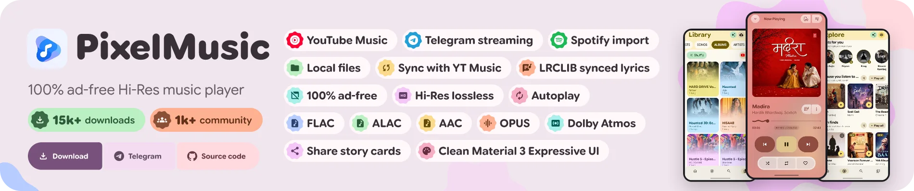
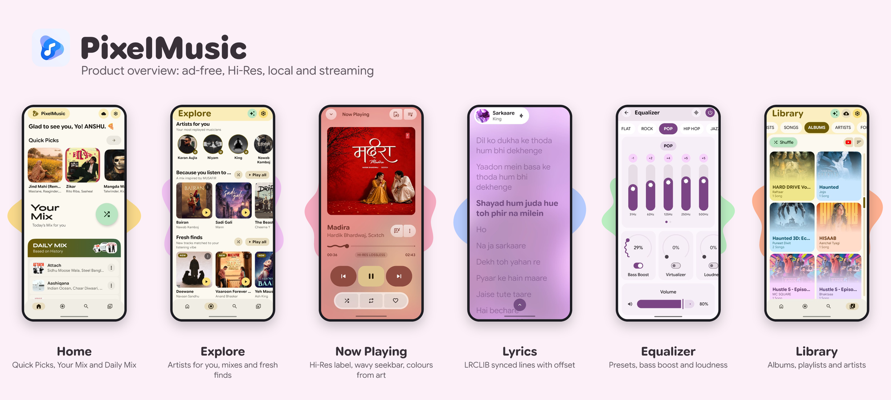
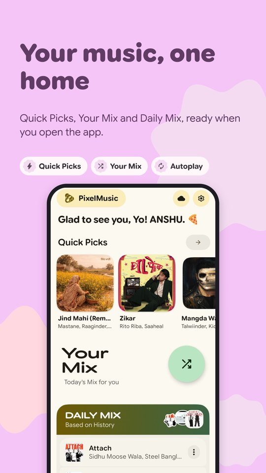
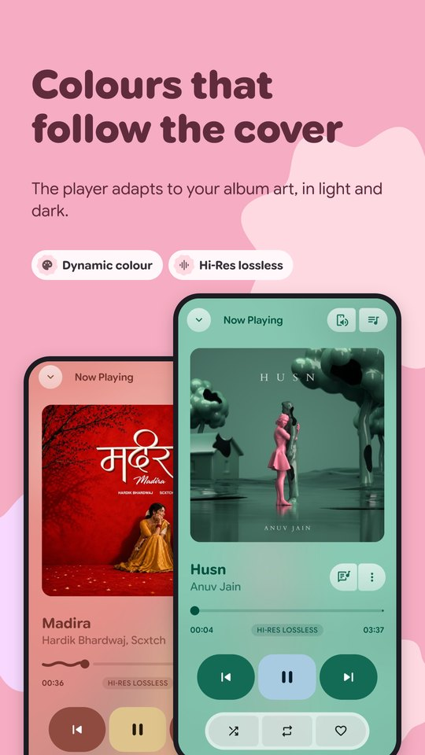

<div align="center">



<br>

# PixelMusic (Pixel Music)

**Modern, open-source Android music player with Material 3 Expressive, TV sync, YouTube Music streaming, and Mochy-style smooth transport transitions.**

[-3DDC84?style=for-the-badge&logo=android&logoColor=white)](https://android.com)
[](https://kotlinlang.org)
[](LICENSE)
[]()
[]()

<br>

<p align="center">
  <a href="https://github.com/Arhetip994/cashierhelper/releases"><b>Download APK</b></a> •
  <a href="#features"><b>Features</b></a> •
  <a href="#tv-sync"><b>TV Sync</b></a> •
  <a href="#audio-transitions"><b>Transitions</b></a> •
  <a href="#tech-stack"><b>Tech Stack</b></a> •
  <a href="#building"><b>Building</b></a> •
  <a href="#license"><b>License</b></a>
</p>

</div>

---

## Overview

**PixelMusic** is an advanced, privacy-friendly Android music player combining local lossless audio playback, online YouTube Music streaming, cross-device TV synchronization, and Material 3 Expressive styling into one cohesive app.

There are **zero advertisements**, no subscriptions, and no analytics tracking. Everything is designed for high performance, smooth animations, and top-tier audio quality.

<div align="center">

</div>

---

## Key Features

### 📺 Instant TV Sync via QR Code
- **Google Code Scanner**: Fast and privacy-preserving scanner with automatic zoom (`enableAutoZoom`) that works directly on-device without camera permission dialogs.
- **Bi-directional Sync**: Scan the QR code from the **PixelMusic TV** app to instantly cast or import playlists, queues, and tracks directly to your big screen.
- **Manual Input Fallback**: Full support for manual payload or IP entry if camera access is unavailable.

### 🌐 YouTube Music Search & Online Streaming
- **InnerTube Integration**: Fast online search for tracks, albums, and artists with instant search suggestions.
- **Seamless Inline Playback**: Online tracks resolve directly into the playback queue alongside your local library.
- **Studio Artwork Resolver**: Automatically fetches and caches high-definition album art for tracks and albums.

### 🎚️ Mochy-Style Transport Transitions
- **Clean Transport Fades**: Inspired by [Mochy-Music](https://github.com/realidkroo/Mochy-Music), manual song skips (Next / Previous) and queue picks ease out over ~300ms using a smooth Hermite curve (`smoothstep`), switch tracks silently at zero volume, and ease the new track in.
- **Zero Sound Collisions**: Eliminates chaotic simultaneous double-player playback and buffer pops on skip.
- **Instant Double-Tap Response**: Double-tapping the Next button cancels any in-flight fade and skips immediately with zero latency.
- **Smooth Play/Pause & ReplayGain Preservation**: Gentle fade-out on pause, gentle fade-in on resume, with full volume normalization preservation.

### 🎧 Audiophile Playback Engine
- **Hi-Res Lossless Support**: Native bit-perfect playback for **FLAC, ALAC, WAV, APE, OPUS, OGG, and MP3**.
- **10-Band Graphic Equalizer**: Built-in equalizer with customizable presets, bass boost, and virtualizer.
- **ReplayGain & Volume Normalization**: Automatic EBU R128 loudness leveling across tracks and sources.
- **Pitch & Speed Control**: Independent time-stretching and playback speed controls.

### 🎨 Material 3 Expressive Design
- **Dynamic Color**: Automatically extracts vibrant tonal color schemes from current track artwork (Monet).
- **Multiple Theme Styles**: Full support for Light, Dark, Pure Black (AMOLED), and System Default themes.
- **Adaptive Mini-Player & Full Sheet**: Fluid gestures, drag-to-dismiss queue bottom sheet, and expressive typography.
- **Modern Glance Widgets**: Beautiful homescreen widgets in 4x1, 4x2, and 2x2 sizes.

### 📝 Synced Lyrics (LRCLIB & NetEase)
- **Time-Synced Lyrics**: Line-by-line and word-by-word karaoke highlighting.
- **Manual & Auto Search**: Adjustable timing offset, translation, and romanization for non-Latin scripts.

---

## Screenshots

<div align="center">
  
  
  
</div>

---

## Tech Stack

| Component | Library / Framework | Purpose |
|---|---|---|
| **Language** | Kotlin 2.x | 100% modern Kotlin with Coroutines & Flows |
| **UI Framework** | Jetpack Compose (BOM) | Declarative UI with hardware acceleration |
| **Design System** | Material 3 Expressive | Fluid adaptive layouts and dynamic theming |
| **Media Player** | AndroidX Media3 (ExoPlayer) | Audio pipeline, foreground service, and media sessions |
| **QR & Barcode** | Google Code Scanner (Play Services) | Instant TV sync QR code recognition with auto-zoom |
| **Dependency Injection** | Dagger Hilt | Modular DI for ViewModels, Services, and Repositories |
| **Database** | Room + KSP | SQLite caching for library, playlists, and history |
| **Image Loading** | Coil 3 | Image decoding and cached album artwork |
| **Networking** | OkHttp & Ktor Client | High-performance HTTP client with Brotli support |

---

## Building from Source

### Prerequisites
- **JDK 21** or higher
- **Android SDK** with build tools 35+
- **Gradle 9.x** (wrapper provided)

### Build Commands

```bash
# Clone the repository
git clone https://github.com/Arhetip994/cashierhelper.git
cd cashierhelper

# Compile Kotlin & run verification
./gradlew compileDebugKotlin

# Build Debug APK
./gradlew assembleDebug

# Output APK path:
# app/build/outputs/apk/debug/app-arm64-v8a-debug.apk
```

### Installing via ADB

```bash
adb install -r -d app/build/outputs/apk/debug/app-arm64-v8a-debug.apk
```

---

## Disclaimer

PixelMusic is an independent, community-driven audio player. It is not affiliated with Google LLC, YouTube, Deezer, Telegram, Last.fm, or ListenBrainz. All third-party brand names and logos belong to their respective owners.

---

## License

PixelMusic is licensed under the **GNU General Public License v3.0**. See the [LICENSE](LICENSE) file for more information.
Portions of the codebase are derived from open-source projects including PixelPlayerOSS and Mochy-Music.
